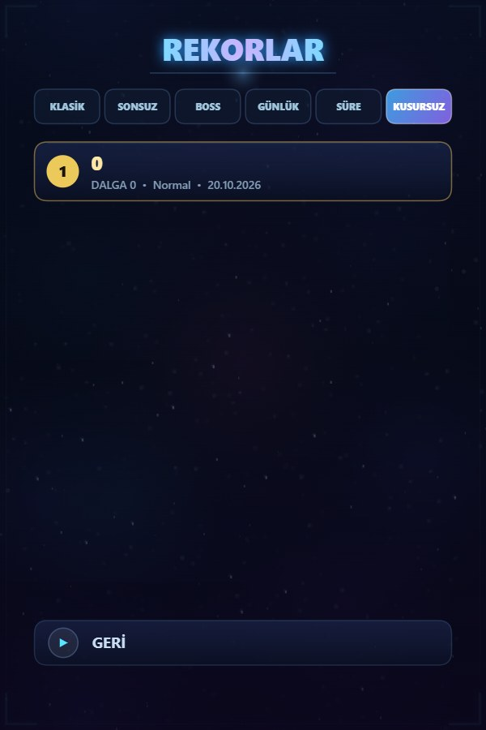

# Yıldız Akını

**Neon galakside hayatta kal.**

Tek dosyalık HTML5 uzay savaşı. Tarayıcıda aç, telefona kur; internet, reklam veya hesap gerekmez.

## Oyun nedir?

**Yıldız Akını**, tek bir HTML dosyasında çalışan dikey bir neon uzay savaşı oyunudur. Ateş otomatiktir; sen sadece konumlanır, kaçar ve doğru anda patlarsın. Dalgalar ilerledikçe düşmanlar sertleşir, her beş dalgada bir boss gelir ve her üç dalgada bir yükseltme seçersin.

Oyun tamamen çevrimdışıdır. Ne bir sunucu, ne bir hesap, ne de harici bir görsel/ses dosyası vardır: grafikler Canvas 2D ile, müzik ve efektler Web Audio API ile anlık üretilir.

## Öne çıkanlar

| Alan | İçerik |
|---|---|
| **Gemiler** | 6 gemi · her biri farklı hız, can, bomba ve aktif yetenek |
| **Yetenekler** | Overload, Blink, Barrier, Supernova, Phase, Salvo |
| **Savaş** | Otomatik ateş, dash, bomba, graze, combo, yenilenen kalkan, drone, güdümlü füze, yörünge silahı |
| **Yükseltmeler** | Koşu içinde 30 farklı perk · her geminin kendi 4 dallı kalıcı ağacı |
| **Modlar** | Klasik, Sonsuz, Boss Akını, Günlük Görev, Zaman Yarışı, Kusursuz |
| **Dünyalar** | 5 galaksi bölgesi · bölgeye göre değişen arka plan, parçacık ve müzik tonu |
| **Düşmanlar** | 8+ düşman tipi, formasyonlar, asteroid fırtınası, çok fazlı boss'lar, Queen ve Fortress |
| **Görevler** | Her gün 3 görev · her hafta 3 görev · aynı gün herkese aynı görev seti |
| **Koleksiyon** | 8 gemi skini · 3 iz efekti · 2 patlama efekti · ilerlemeyle açılır |
| **Başarımlar** | 31 başarım · 12 kartlık istatistik paneli · son 10 koşu grafiği |
| **Kontroller** | Dokunmatik, klavye, fare ve gamepad |
| **Erişilebilirlik** | TR/EN, renk körü modu, azaltılmış hareket, sarsıntı ve parçacık ayarı, FPS sayacı |

## Ekran görüntüleri

| Ana menü | Savaş | Modlar |
|:---:|:---:|:---:|
|  |  |  |
| **Hangar** | **Yükseltme ağacı** | **Görevler** |
|  |  |  |
| **İstatistikler** | **Koleksiyon** | **Dokunmatik HUD** |
|  |  |  |

## İndir

### Android · APK

[**Yildiz-Akini.apk**](Yildiz-Akini.apk) · **174 KB** · Android 5.0+ · sürüm **8.0** (versionCode 8)

- Tam ekran, portre, ikonlu ve çevrimdışı.
- APK **internet izni istemez**; hiçbir veri cihazdan çıkmaz.
- Sideload için debug anahtarıyla imzalanmıştır. Play Protect "bilinmeyen uygulama" uyarısı verebilir.

### Bilgisayar · Tarayıcı

[**yildiz-akini.html**](yildiz-akini.html) · **252 KB** · Chrome, Edge, Firefox veya Safari

Dosyayı indirip çift tıklaman yeterli. Kurulum, sunucu veya internet bağlantısı gerekmez.

> Sürüm notları: [CHANGELOG.md](CHANGELOG.md) · Kararlı sürüm: [Releases](https://github.com/Saklabann/yildiz-akini/releases)

## Oyun modları

| Mod | Açıklama |
|---|---|
| **Klasik** | Ana deneyim. Boss her 5 dalgada, yükseltme her 3 dalgada. |
| **Sonsuz** | 20. dalgedan sonra tehlike durmadan artar; amaç hayatta kalabildiğin kadar kalmak. |
| **Boss Akını** | Sadece boss savaşları. Arka arkaya dev patronlar. |
| **Günlük Görev** | Günün tohumu: herkes aynı akışı oynar. Günde bir kez ödül. |
| **Zaman Yarışı** | 90 saniyede en yüksek skor. Kalan süre bonus, skor çarpanı %30. |
| **Kusursuz** | Can kaybettiğin an koşu biter. Kalkan emişi serbesttir. |

## Gemiler

| Gemi | Profil | Aktif yetenek |
|---|---|---|
| **Denge** | Dengeli hız ve ateş | Overload — kısa süreli ateş gücü patlaması |
| **Şimşek** | Çok hızlı, kırılgan | Blink — anlık ışınlanma |
| **Kale** | Dayanıklı, yavaş | Barrier — geçici kalkan |
| **Nova** | Seri ateş, dengeli gövde | Supernova — ekranı yakıp geçen patlama |
| **Hayalet** | Çevik ama kırılgan | Phase — kısa süreli dokunulmazlık |
| **Titan** | Ağır zırh, dört bomba | Salvo — roket yağmuru |

Her geminin kendi **Motor / Gövde / Silah / Çekirdek** dallarından oluşan 11 düğümlük kalıcı yükseltme ağacı vardır. Yükseltmeler coin ile alınır ve gemiye özeldir.

## İlerleme ve ekonomi

- **Coin**: koşu içinde ve dışında kazanılır; mağaza ve gemi ağacında harcanır.
- **Yıldız tozu**: nadir para birimi; özel mağaza ürünleri ve kozmetikler için kullanılır.
- **Mağaza**: başlangıç kalkanı, ekstra bomba, mıknatıs, silah seviyesi, altın paleti, yan silah çipi ve öfke.
- **Görevler**: 3 günlük + 3 haftalık görev; ilerleme otomatik sayılır, ödül elle alınır. Haftalık görevler pazartesi yenilenir.
- **Kozmetikler**: 8 skin, 3 iz ve 2 patlama efekti; kill, dalga, boss ve başarım koşullarıyla açılır.
- **Kayıtlar**: cihazda `localStorage` içinde tutulur. Hesap veya bulut gerekmez.

## Kontroller

| Girdi | İşlev |
|---|---|
| **WASD / Ok tuşları / Fare / Dokunma / Gamepad** | Hareket |
| **Otomatik** | Ateş |
| **Shift** | Dash |
| **E** | Gemi yeteneği |
| **B** | Bomba |
| **U** | Öfke (rage) |
| **1 · 2 · 3** | Yükseltme seçimi |
| **P / Esc** | Duraklat |
| **M** | Sesi aç/kapat |
| **F** | Tam ekran |

Mobilde ekranın sol yarısını sürükleyerek hareket edersin; sağ alttaki butonlar bomba, dash ve yetenek içindir. Arayüz tek elle oynanacak şekilde yerleştirilmiştir.

## Kurulum

### Android

1. [Yildiz-Akini.apk](Yildiz-Akini.apk) dosyasını telefona indir.
2. Dosyayı aç. "Bilinmeyen kaynaklara izin ver" istenirse tarayıcı/dosya yöneticisi için izni ver.
3. Play Protect uyarısında **Yine de yükle** seçeneğini kullan.
4. **Yıldız Akını** ikonuna dokun.

Ayrıntılı adımlar: [APK-KURULUM.txt](APK-KURULUM.txt)

### Windows / macOS / Linux

1. [yildiz-akini.html](yildiz-akini.html) dosyasını indir.
2. Çift tıkla. Oyun varsayılan tarayıcıda açılır.
3. Tam ekran için **F** tuşuna bas.

## Teknik

| | |
|---|---|
| **Motor** | Saf HTML5 Canvas 2D, tek IIFE, bağımlılık yok |
| **Mantıksal çözünürlük** | 480 × 720 (dikey), DPR'ye duyarlı ölçekleme |
| **Ses** | Web Audio API ile prosedürel müzik ve efektler |
| **Kayıt** | `localStorage` (`ya_profile`, `ya_settings`) |
| **Dosya boyutu** | HTML ~252 KB · APK ~174 KB |
| **APK** | WebView sarmalayıcı · `com.saklabann.yildizakini` · minSdk 21 · targetSdk 29 |
| **Ağ** | Hiçbir ağ isteği yok; APK'da `INTERNET` izni yok |
| **Derleme** | Gradle'sız: `aapt2` + `javac` + `d8` + `jarsigner` |

Mimari ve kod düzeni: [docs/TEKNIK.md](docs/TEKNIK.md)

## SSS

**Oyun ücretsiz mi?**
Evet. Reklam, uygulama içi satın alma veya abonelik yoktur.

**İnternet gerekiyor mu?**
Hayır. Hem HTML hem APK tamamen çevrimdışı çalışır.

**Verilerim nereye gidiyor?**
Hiçbir yere. Skorlar, ayarlar ve koleksiyon yalnızca cihazın yerel deposunda tutulur.

**Güncelleme kayıtlarımı siler mi?**
Aynı paket adı ve imzayla üzerine kurulduğunda hayır.

**Neden Play Protect uyarısı çıkıyor?**
APK mağaza dışı dağıtım için kendi debug anahtarıyla imzalandığından Google sertifika zincirini tanımaz. Uyarı beklenen bir durumdur.

**iOS'ta oynanır mı?**
HTML dosyası Safari'de çalışır. Şu an imzalı bir iOS paketi yoktur.

**Kaynak kodu değiştirebilir miyim?**
Depo özeldir ve tüm hakları saklıdır. Kullanım koşulları için [LICENSE](LICENSE) dosyasına bak.

## Yol haritası

v9 için değerlendirilen başlıklar: odak modu ve lazer, şarjlı atış, elit düşmanlar, boss zayıf noktaları, haftalık mutatör modu, yardım modu, sol el düzeni ve kayıt dışa aktarma.

Ayrıntılar: [ROADMAP.md](ROADMAP.md)

## English

**Yıldız Akını** (Star Rush) is a single-file, offline neon space shooter built with HTML5 Canvas and Web Audio. It ships as both a standalone HTML game and a tiny Android APK.

- 6 ships with unique abilities, 6 game modes, 5 galaxy regions
- 30 run perks plus a per-ship permanent upgrade tree
- Daily and weekly missions, 31 achievements, detailed stats
- 8 skins, 3 trails, 2 explosion styles
- Touch, keyboard, mouse and gamepad support
- Turkish and English UI, colorblind mode, reduced motion
- No ads, no accounts, no analytics, no network requests

Download the [APK](Yildiz-Akini.apk) or the [HTML file](yildiz-akini.html) and play.

## Lisans

© 2026 Saklabann. Tüm hakları saklıdır. Bu depo ve içindeki oyun; kod, görsel ve ses varlıkları dahil olmak üzere yazılı izin olmadan çoğaltılamaz, dağıtılamaz veya ticari olarak kullanılamaz. Ayrıntılar için [LICENSE](LICENSE).

---

**İyi akınlar.** · [Sürüm notları](CHANGELOG.md) · [Güvenlik](SECURITY.md) · [Katkı](CONTRIBUTING.md)

