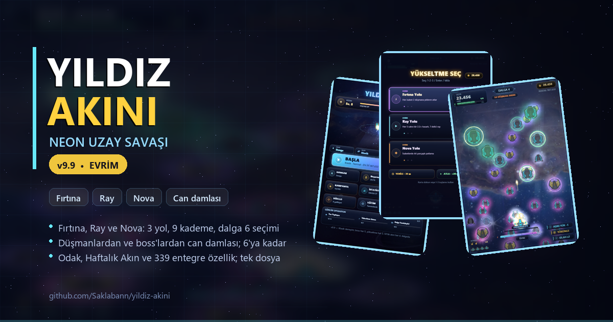
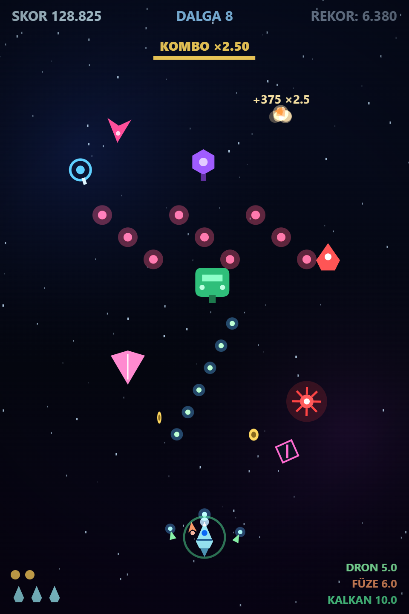
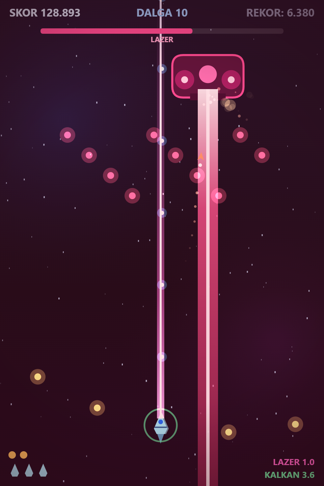
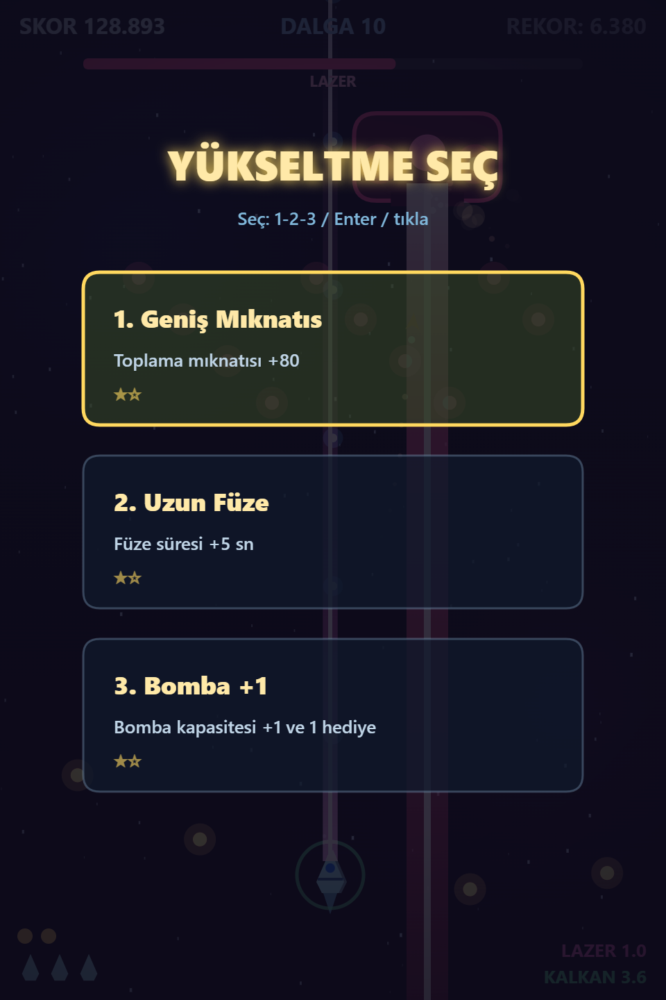
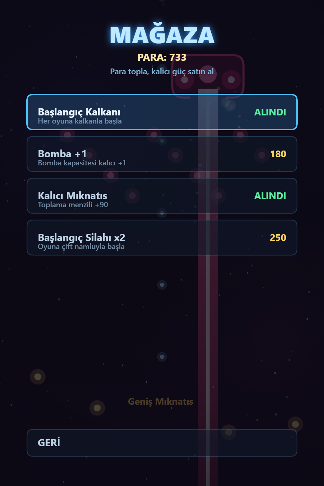

# ⭐ Yıldız Akını

### Neon galakside hayatta kal!

**Tek dosyalık neon uzay savaşı oyunu** — 60+ özellik · kurulum yok · internet gerekmez.
Müzik ve ses efektleri tarayıcıda (Web Audio) sıfırdan üretilir.

---

## 🎮 Oyun nedir?

Küçük bir gemiyle bir neon galakside hayatta kalmaya çalışıyorsun: düşman dalgaları,
asteroid fırtınaları, boss savaşları, paralar ve mağaza... Ateş otomatiktir; sen sadece
hayatta kal. **Klavye, fare, dokunmatik ve gamepad** desteklenir.

Tek bir HTML dosyası — çift tıkla, oyna. İstersen derlenmiş **Android APK** ile telefonda
gerçek bir uygulama gibi (tam ekran, ikonlu, internetsiz) çalıştır.

## ✨ Özellikler (60+)

### 🚀 Gemi & zorluk
- **3 gemi**: Denge, Hız ve Tank (can / hız / bomba farklılıkları)
- **3 zorluk**: Kolay, Normal, Zor
- **Otomatik ateş** + 3 kademeli yayılım ve hızlı ateş güçlendirmesi

### 🎯 Savaş mekanikleri
- **Combo sistemi** — seri yok etmede artan skor çarpanı
- **Graze** — kurşunu kıl payı sıyırıp bonus puan toplama
- **Atılma (Dash)** — kısa dokunulmazlık + iz efekti
- **Bomba (B)** — ekranı temizle
- **Yenilenen kalkan** ve **ikinci şans** (diriliş) yükseltmesi
- **Güdümlü füzeler · lazer ışını · refakat dronları · mıknatıs** güçlendirmeleri

### 👾 Düşmanlar & bosslar
- 8+ düşman tipi: izci, dalıcı, ateşçi, tank + **bölünen, keskin nişancı, yörüngeci, mayın**
- **Elit düşmanlar** (parlar, ekstra dayanıklı, bol ödül)
- Formasyon dalgaları ve **asteroid fırtınası** (her 7. dalga)
- **3 boss tipi** (yayılım / lazer / füze) — her 5. dalgada sırayla gelir
- **Boss 2. fazı** — %50 can altında kızarır, hızlanır, yeni saldırı açar
- **UFO bonusu** — vur, kargo sandığı kazan

### 🌟 İlerleme & ekonomi
- Her 3. dalgada **16 farklı roguelite yükseltmeden 3 seçenek**
- **Coin ekonomisi** + kalıcı **mağaza** (başlangıç kalkanı, +bomba, mıknatıs, +silah)
- **12 başarım**, istatistik sayfası, **yerel Top-5 rekor tablosu**
- Kusursuz dalga bonusu; kayıtlar cihazda saklanır (localStorage)

### 🎨 Görsel & işitsel
- Prosedürel müzik ve ses efektleri (harici dosya yok)
- Parçacıklar, şok dalgaları, ekran sarsıntısı, **ağır çekim + zoom** (boss ölümünde)
- **TR / EN** anında dil değiştirme, **renk körü paleti**, azaltılmış hareket seçeneği
- CRT scanline efekti, FPS sayacı, kayan yıldızlı canlı arka plan

### 📱 Kontroller
- Klavye (WASD / oklar) · Fare · **Dokunmatik joystick + bomba/dash butonları** · **Gamepad**
- Duraklat (P/Esc), ses (M), tam ekran (F), atılma (Shift), bomba (B)
- Sekme arkaya atılınca otomatik duraklama

## 📸 Ekran Görüntüleri

| Aksiyon | Boss savaşı |
|---|---|
|  |  |

| Yükseltme seç | Mağaza |
|---|---|
|  |  |

## 📥 İndir & Kur

### 📱 Android (APK)
[**Yildiz-Akini.apk**](Yildiz-Akini.apk) dosyasını indirip telefona kur — Android 5.0+.
Dikey tam ekran açılır; sol yarıda parmağını sürükleyerek hareket et, sağ alttaki
butonlarla bomba ve atılma kullan.

> Kurulum: APK'yı aç → "Bilinmeyen kaynaklara izin ver" → Yükle.

### 💻 Bilgisayar / tarayıcı
[**yildiz-akini.html**](yildiz-akini.html) dosyasını indirip çift tıkla — her modern
tarayıcıda çalışır. Klavye veya fareyle oynanır; tam ekran için **F**.

## ⌨️ Kontroller

| Tuş | İşlev |
|---|---|
| **WASD / Ok tuşları / Fare / Dokunma** | Hareket |
| **Ateş** | Otomatik |
| **Shift** | Atılma (kısa dokunulmazlık) |
| **B** | Bomba |
| **P / Esc** | Duraklat |
| **1 · 2 · 3** | Yükseltme seç |
| **M** | Ses aç/kapa |
| **F** | Tam ekran |

## 🗓️ Sürüm Geçmişi

- **v1** — İlk sürüm: temel dikey uzay savaşı.
- **v2** — **60+ yenilik**: 3 gemi, 3 zorluk, combo + graze, dash & bomba, kalkan,
  4 yeni düşman, elitler, 3 boss (2 fazlı), asteroid dalgaları, UFO & sandık,
  mağaza + coin, 16 yükseltme, 12 başarım, istatistik, rekor tablosu, TR/EN,
  ayarlar, dokunmatik + gamepad, ağır çekim, müzik sistemi...

## 🔧 Teknik

- Tek dosya: `yildiz-akini.html` (~108 KB, harici bağımlılık yok)
- Motor: saf **HTML5 Canvas 2D** · Ses: **Web Audio API** · Kayıt: `localStorage`
- APK: minik WebView sarmalayıcı — aapt2 + d8 + jarsigner ile Gradle'sız derlendi
- Paket adı: `com.saklabann.yildizakini` · Sürüm 2.0 · Android 5.0+ (API 21)

---

**⭐ İyi akınlar!**

